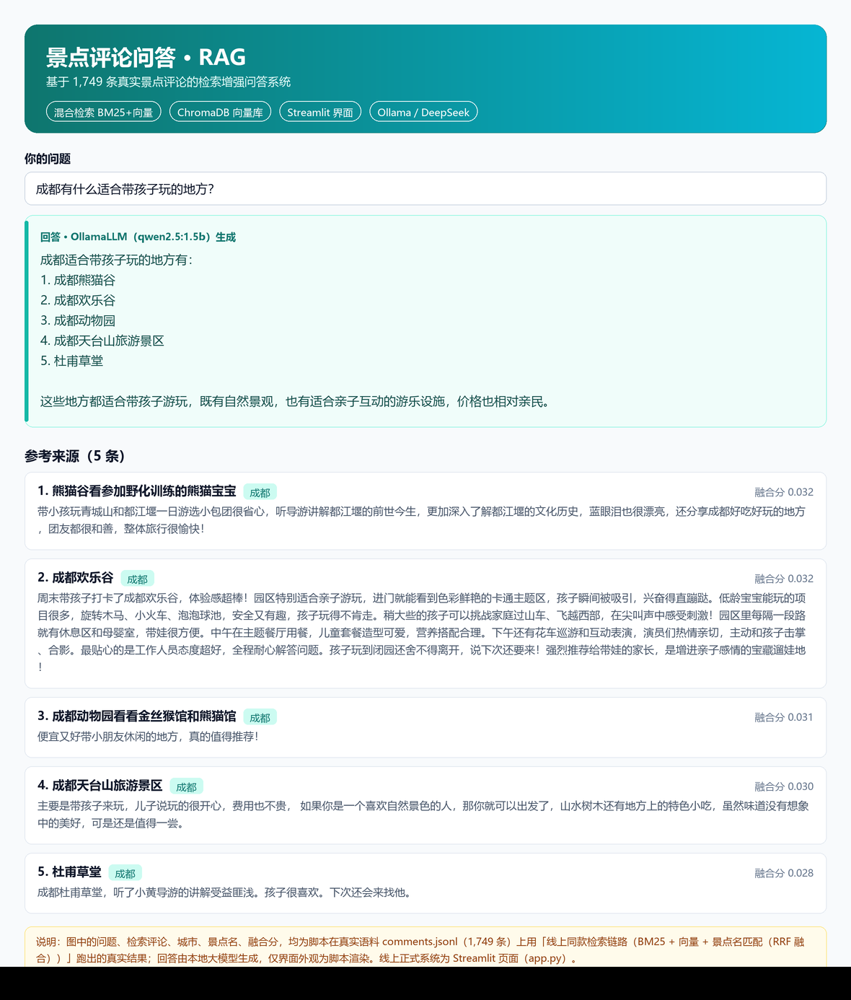
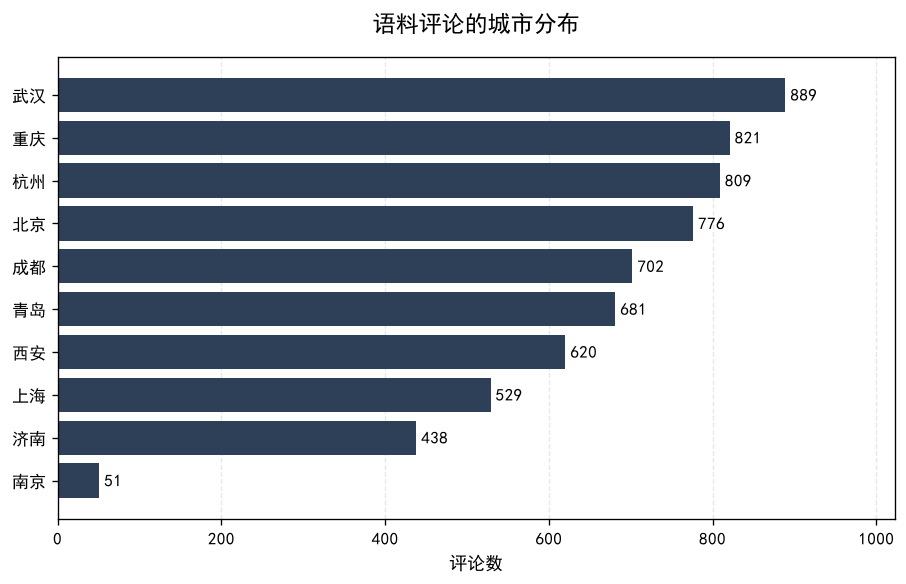
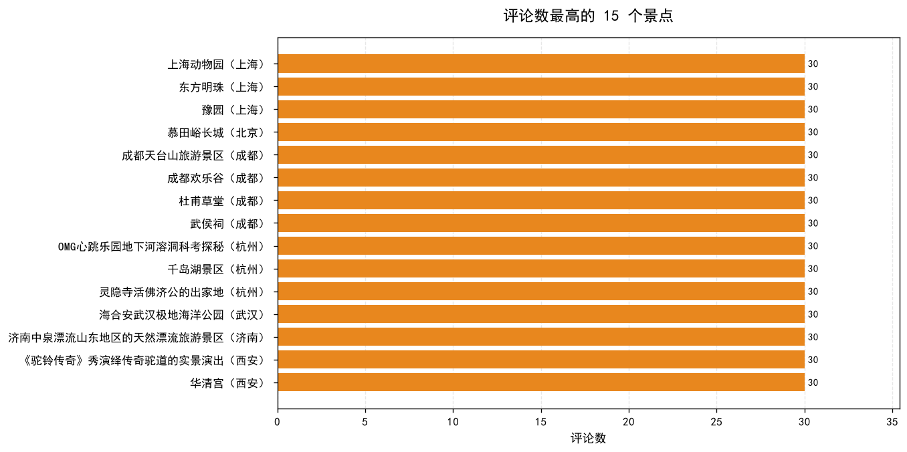
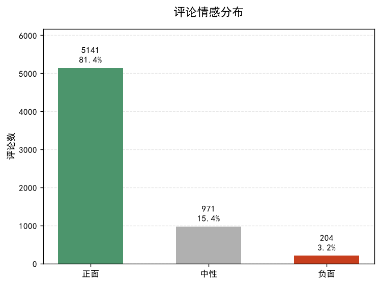
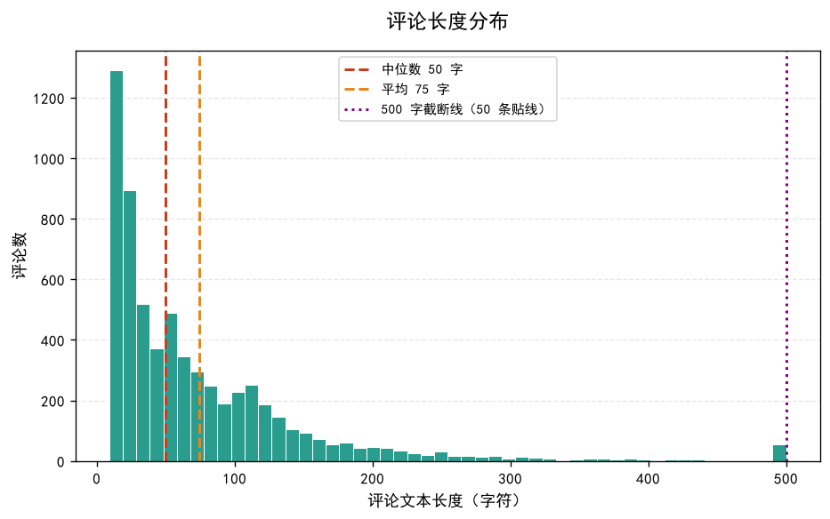
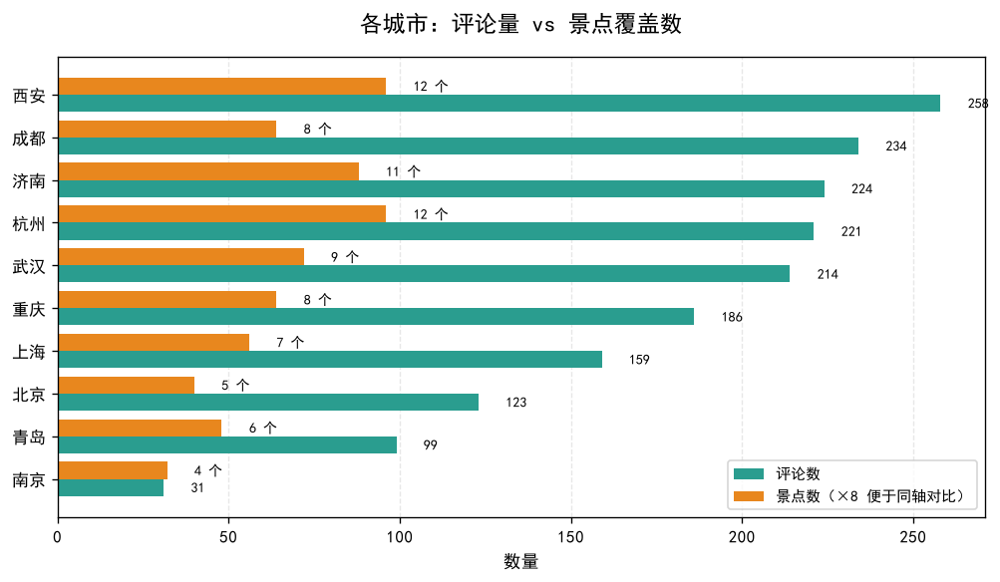
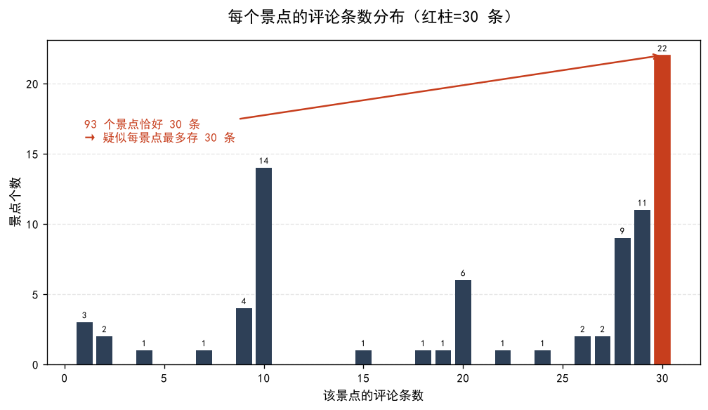
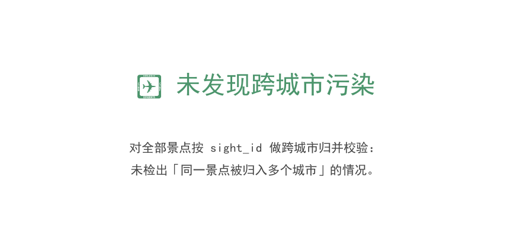
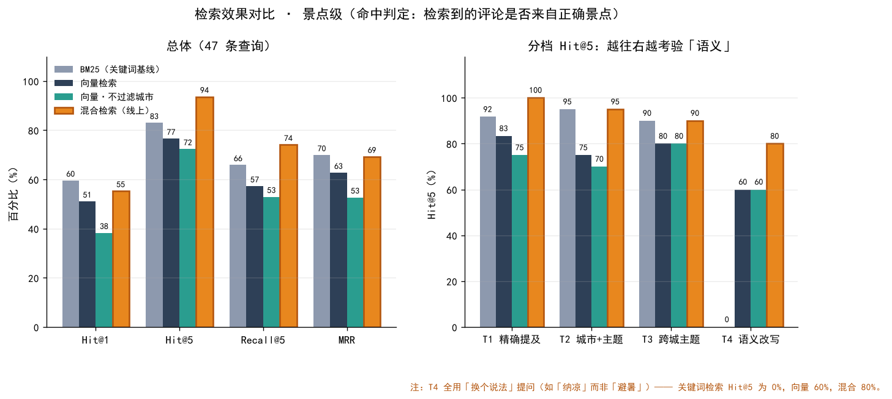

# 景点评论 RAG 问答系统


> 用 **1749 条真实景点评论**搭建的检索增强生成（RAG）问答系统。
> 问它"带孩子去成都玩，推荐去哪""西安兵马俑值不值得去"，它会**基于真实游客评论**回答，并给出原文出处。



**技术栈**：Python · sentence-transformers（MiniLM） · ChromaDB · BM25 · Streamlit · Ollama / DeepSeek
**核心能力**：**混合检索**（BM25 + 向量 + 景点名匹配，RRF 融合） · 城市限定过滤 · 出处可溯 · **检索效果有量化评测**

> 📊 不是"感觉效果不错"：`eval/` 里有 **47 条查询的分档评测**，
> 线上这套混合检索的 **Hit@5 = 93.6%、Recall@5 = 74.1%**，
> 而纯关键词检索在「换个说法问」的那一档 **Hit@5 = 0%**。指标与复现方式见 [`eval/README.md`](eval/README.md)。


---

## 问题

数据来源：去哪儿网 10 个热门旅游城市（北京、上海、武汉、成都、西安、重庆、青岛、杭州、济南、南京）的景点评论。

游客在做决策时真正想知道的是：

1. **"这个景点到底值不值得去？"**
2. **"带小孩适合去哪？"**
3. **"门票贵不贵、有没有坑？"**

传统的做法是翻几十条评论自己看。这个项目用 **RAG** 让机器来读，直接给答案。

---

## 它是什么（RAG 一句话解释）

```
用户提问 → ① 向量化 → ② 检索最相关的评论 → ③ 连同问题喂给大模型 → ④ 基于评论生成答案（附出处）
```

**为什么要 RAG，不让大模型直接答？**
- 大模型**不知道**这些评论的内容（训练数据里没有）
- 大模型会**瞎编**（幻觉）——RAG 用"只根据检索到的评论回答"来约束它
- 让答案**可追溯**：每条结论都能点回原文

---

## 架构

```
┌────────────────────────────────────────────┐
│  Streamlit 网页界面 / 命令行                │
└─────────────────┬──────────────────────────┘
                  ↓
┌────────────────────────────────────────────┐
│  混合检索（src/hybrid.py）                  │
│   ① BM25 关键词召回  ┐                      │
│   ② 向量语义召回      ├→ RRF 融合 → 景点名   │
│   ③ 景点名精确匹配   ┘   加权 → 多样性重排   │
│   向量模型: 本地 MiniLM    向量库: ChromaDB  │
├────────────────────────────────────────────┤
│  生成：Ollama 本地 / 云端 API（可插拔）      │
└─────────────────┬──────────────────────────┘
                  ↓
┌────────────────────────────────────────────┐
│  1749 条评论 → 分块 → 向量 → 入库            │
└────────────────────────────────────────────┘
```

**为什么要混合检索**（三路信号各自解决一个问题，都是评测跑出来的结论）：

| 信号 | 解决什么 | 单独用会怎样 |
|---|---|---|
| **向量检索** | 用户「换个说法问」时也能召回 | 小模型语义精度有限，整体不如关键词 |
| **BM25** | 词面精确命中，稳定 | 「纳凉」vs「避暑」这类改写直接归零 |
| **景点名匹配** | 问题点名了景点却被他景点评论抢词 | 问「兵马俑」，排最前的却是「兵马俑+华清宫一日游」游记 |

**设计要点：可插拔 LLM**
- 默认：本地 `Ollama` + `qwen2.5:1.5b`（集显笔记本可跑，零成本）
- 可选：云端 API（配了 `DEEPSEEK_API_KEY` 即自动切换）

**设计要点：可插拔检索后端**（`RETRIEVER` 环境变量：`hybrid` / `vector` / `bm25`）
—— 三种后端共用同一套评测（`eval/run_eval.py`），换后端能立刻看到指标变化。


---

## 快速开始

> ⚠️ **国内网络必读**：`huggingface.co` 与 `github.com` 直连不通，本文档所有下载步骤都已改用国内镜像。

### 1. 安装依赖

```bash
pip install -r requirements.txt
```

### 2. 准备向量模型（手动下载，绕过 HF 下载器）

HF 官方下载器在镜像环境下会写出 0 字节空文件，因此**用 curl 逐个文件拉取**：

```bash
mkdir -p models/minilm && cd models/minilm
BASE="https://hf-mirror.com/sentence-transformers/paraphrase-multilingual-MiniLM-L12-v2/resolve/main"
for f in config.json config_sentence_transformers.json modules.json \
         sentence_bert_config.json tokenizer.json tokenizer_config.json \
         special_tokens_map.json model.safetensors; do
  curl -L -C - -o "$f" "$BASE/$f"
done
mkdir -p 1_Pooling
curl -L -o 1_Pooling/config.json "$BASE/1_Pooling/config.json"
```

> 合计约 460MB（其中 `model.safetensors` 449MB）。程序会**自动优先从本地 `models/minilm/` 加载**。

### 3. 建索引（把评论向量化入库）

```bash
python src/build_index.py
```

> ⚠️ **ChromaDB 中文路径限制**：ChromaDB 1.x 的 Rust 内核**无法在含中文的路径下写入 HNSW 索引**。
> 本项目已自动处理——若项目路径含中文，向量库会写到 `~/.scenic_rag/chroma_db`（可用环境变量 `CHROMA_DIR` 覆盖）。

### 4. 命令行问答

```bash
python src/rag.py "武汉哪个公园适合带孩子"
python src/rag.py "黄鹤楼值不值得去" -v        # -v 显示检索详情
python src/rag.py "有什么适合亲子的" -c 杭州   # -c 指定城市
```

### 5. 大模型后端（可选）

后端按 `ollama → cloud → mock` 顺序自动选择，**任一不可用会自动回退**，不会报错中断。

**方案 A：本地 Ollama（推荐，零成本、离线）** ✅ 已验证可用

```bash
ollama pull qwen2.5:1.5b     # 986MB
```

> ⚠️ **国内安装 Ollama 主程序的坑**：官网 `ollama.com/download` 会 307 跳转到 `github.com`（不通）。
> 命令行镜像（ghfast.top / ghproxy.net）实测只有 50–188KB/s，1.5GB 要 2–8 小时，**不实用**。
> ✅ **可行做法**：浏览器把梯子切到「系统代理模式」，直接访问 https://ollama.com/download/windows 下载。
> 装好后 `ollama pull` 走 `registry.ollama.ai`，**该域名国内可直连**，速度正常。

**方案 B：云端 API（效果最好）**

```bash
set LLM_PROVIDER=cloud
set DEEPSEEK_API_KEY=你的key
```

**方案 C：离线 Mock**：不依赖模型服务，把检索到的评论原文整理输出，用于验证检索效果。

### 6. 网页界面

```bash
streamlit run app.py
```

### 7. 数据看板（了解语料长什么样）

```bash
python src/dashboard.py
```

输出到 `results/dashboard/`：城市分布、城市覆盖 vs 评论量、情感分布、长度分布、
评论数 Top15、每景点评论数分布，以及一张 **`07_quality_suspects.png` 数据质量图**。

### 8. 检索效果评估（看检索到底准不准）

```bash
python eval/run_eval.py        # 输出 eval/results.md + results/eval/retrieval_metrics.png
```

> 47 条查询 × 4 档难度 × 3 种检索后端，输出 Hit@k / Recall@k / MRR。
> 设计说明与结论见 [`eval/README.md`](eval/README.md)。

### 9. 切换检索后端（做消融对比用）

```bash
set RETRIEVER=vector    # 纯向量
set RETRIEVER=bm25      # 纯关键词
set RETRIEVER=hybrid    # 默认：混合检索
```

> 改完直接跑 `eval/run_eval.py` 就能看到指标变化。


> ⭐ 这个脚本不只是"画图"，它内置了一道**数据质量自检**：
> 自动找出「景点名里含其他城市名」的记录 —— 也就是**跨城市污染**。
> **当前运行结果为「未发现跨城市污染」** —— 因为语料已换用一号作品重建后的干净数据
> （此前基于旧语料时，该检测曾抓出 16 个可疑景点 / 330 条评论）。

---

## 项目结构

```
scenic-rag/
├── data/
│   └── comments.jsonl        # 1749 条评论（从一号作品导出）
├── src/
│   ├── export_comments.py    # 导出评论数据
│   ├── build_index.py        # 建向量索引
│   ├── bm25.py               # BM25 关键词检索（字符 n-gram，无需分词库）
│   ├── retriever.py          # 向量检索（ChromaDB + MiniLM）
│   ├── hybrid.py             # 混合检索：BM25 + 向量 + 景点名匹配，RRF 融合
│   ├── llm.py                # 可插拔 LLM（Ollama / 云端）
│   ├── rag.py                # RAG 主链路（命令行入口）
│   ├── dashboard.py          # 语料看板 + 数据质量自检
│   └── config.py             # 配置
├── eval/                     # ⭐ 检索效果评估
│   ├── queries.jsonl         # 47 条查询 + 真值标注（规则可复现）
│   ├── run_eval.py           # 跑评测：Recall / Hit / MRR，输出报告与图
│   ├── results.md            # 自动生成的评测报告
│   └── README.md             # 评测设计、结论、局限与改进方向
├── demo/
│   ├── make_qa_shot.py       # 生成首页那张演示图（真实检索 + 真实生成）
│   └── demo_search.py        # 命令行版 BM25 检索（零重依赖的冒烟测试）
├── results/
│   ├── dashboard/            # 语料看板图表
│   ├── eval/                 # 检索效果对比图
│   └── demo/                 # 演示图
└── app.py                    # Streamlit 界面
```


---

## 数据说明

| 项目 | 数值 |
|---|---|
| 源景点 | **151 个**（来自一号作品清洗后的「10 城」数据集） |
| 有评论的景点 | **82 个**（另 69 个景点无评论文本） |
| **评论条数（清洗后）** | **1749 条**（去重后；另剔除过短·无意义 1 条） |
| 城市覆盖 | 10 城（西安 258、成都 234、济南 224、杭州 221、武汉 214、重庆 186、上海 159、北京 123、青岛 99、南京 31） |
| 平均长度 | 约 77 字（中位 54 字） |
| 情感分布 | 正面 1492 / 中性 209 / 负面 48 |

> ✅ **跨城市污染已解决（两轮修复）**：语料来自一号作品**重建后的清洗结果**。
> 第一轮按 `sight_id` 去重修「同景点被多个城市重复抓取」；
> 第二轮发现更严重的**系统性城市误标**——列表页的「周边推荐」把邻市乃至全省、全国景点
> 带进来并打上本地标签，于是对 279 个景点逐条人工核验真实归属，
> 只保留**确实位于这 10 个城市**的景点（499 → 151 条）。
> 本项目的 `dashboard.py` 内置污染自检，**当前运行结果为「未发现跨城市污染」**。

> 以上数字由 `python src/export_comments.py` 重跑验证，**完全可复现**。

评论数据来自[一号作品](https://github.com/koilxz/city-attraction-analysis)的清洗结果，
两个项目构成「**采集 → 清洗 → 分析 → 问答**」的完整数据链路。

---

## 功能

- 🔍 **混合检索**：BM25 关键词 + 向量语义 + 景点名精确匹配，RRF 融合后按景点做多样性重排
- 🏙️ **城市过滤**：问"武汉…"只在该城市评论中检索（自动识别 / 手动指定）
- 📎 **答案可溯源**：每条回答都附带检索到的原始评论出处与分数
- 📊 **有量化评测**：47 条分档查询上的 Hit@k / Recall@k / MRR，可一键复现
- 🔌 **可插拔模型层**：本地 Ollama / 云端 API / 离线 Mock，自动回退
- 🖥️ **网页界面**：Streamlit，含后端状态徽标、城市选择、示例问题

## 实测效果

```
$ python src/rag.py "成都有什么适合带孩子玩的地方？"
正在初始化 RAG 系统……
使用模型后端：ollama
检索方式：BM25 + 向量 + 景点名匹配（RRF 融合）

【回答】
成都有多个适合带孩子玩的地方，例如：
1. 成都熊猫基地：提供野化训练的熊猫宝宝，适合亲子游玩。
2. 成都欢乐谷：适合亲子游玩，有多种低龄宝宝能玩的项目，安全又有趣。
3. 成都动物园：金丝猴馆和熊猫馆，便宜又好带小朋友休闲的地方，值得推荐。
4. 成都天台山旅游景区：适合喜欢自然景色的人，有山水树木和地方特色小吃。
5. 成都杜甫草堂：有小黄导游讲解，受益匪浅，适合喜欢历史文化的游客。
这些地方都适合带孩子玩，是增进亲子感情的宝藏遛娃地。

【参考来源】
  · 成都 - 熊猫谷看参加野化训练的熊猫宝宝（融合分 0.03227）
  · 成都 - 成都欢乐谷（融合分 0.03175）
  · 成都 - 成都动物园看看金丝猴馆和熊猫馆（融合分 0.03058）
  · 成都 - 成都天台山旅游景区（融合分 0.02988）
  · 成都 - 杜甫草堂（融合分 0.02826）
```

> 以上为**真实运行输出**（本地 Ollama `qwen2.5:1.5b`，温度 0.3，每次略有差异）。
> 上面首页那张演示图，就是把这次运行的结果渲染出来的。

> ⚠️ 注意分数是 **"融合分"而不是"相似度"** —— 混合检索用的是 RRF 排名融合分，
> 和余弦相似度不是一个量纲、也不能跨查询比较。展示时如实标注，
> 不把两个概念混着叫（这是本项目改过的一个真实 bug）。

> ⚠️ **这段输出是本项目踩过的最大的坑的产物**。此前版本曾出现「武汉的滕王阁」这类回答 ——
> 滕王阁在南昌，这是**源数据城市标注错误 + LLM 盲信检索结果**共同导致的幻觉。
> 它直接促成了对数据的两轮清洗，详见「局限性」第 5 条。


---

## 📊 语料可视化（了解"知识库"长什么样）

跑一条命令即可生成全部图表：

```bash
python src/dashboard.py        # 输出到 results/dashboard/
```

### 语料分布

| 城市评论量 Top | 景点评论数 Top15 |
|---|---|
|  |  |

### 情感与长度分布

| 评论情感分布 | 评论长度分布 |
|---|---|
|  |  |

<details>
<summary>📂 展开其余 3 张</summary>

| 城市覆盖 vs 评论量 | 每景点评论数分布 |
|---|---|
|  |  |

### ⭐ 数据质量自检（这张最有价值）



> 这不是普通的统计图 —— `dashboard.py` 内置了一道**跨城市污染检测**规则：
> 自动找出「**景点名里含其他城市名**」的记录。
> **当前输出是一张"通过"结论图**：语料换用一号作品重建后的干净数据后，
> 该检测结果已是「**未发现跨城市污染**」。作为对照，旧语料时代这里曾抓出
> **16 个可疑景点 / 330 条评论**（如"上海迪士尼度假区"被标成杭州、
> "重庆欢乐谷"被标成成都），修复过程见「局限性」第 5 条。

</details>

## 📈 检索效果评估（不只是"感觉还行"）

```bash
python eval/run_eval.py       # 输出 eval/results.md + results/eval/retrieval_metrics.png
```

**47 条查询，分四档**（精确提及 / 城市+主题 / 跨城主题 / **语义改写**）。
真值全部写在 `eval/queries.jsonl` 里，**规则可复现**，不是手写几个好例子。



| 系统 | Hit@1 | Hit@3 | Hit@5 | Recall@5 | MRR |
|---|---|---|---|---|---|
| BM25（关键词基线） | 59.6% | 80.9% | 83.0% | 65.9% | 0.699 |
| 纯向量检索 | 51.1% | 72.3% | 76.6% | 57.3% | 0.627 |
| 纯向量·不过滤城市 | 38.3% | 68.1% | 72.3% | 52.9% | 0.527 |
| **混合检索（线上在用）** | 55.3% | **83.0%** | **93.6%** | **74.1%** | 0.693 |

**三个值得讲的结论**：

1. **关键词检索在「换个说法问」时直接归零**：问「纳凉」而语料里只有「避暑」，
   BM25 的 Hit@5 = **0%**，向量/混合仍能命中 —— 这就是必须上语义检索的硬证据。
2. **纯向量检索整体反而不如关键词基线**（Hit@5 76.6% vs 83.0%）：
   MiniLM 只有约 1.18 亿参数，中文细粒度区分度有限。**这是选型事实，不是调参能绕过的。**
3. **所以选混合检索**：两种极端问法都不崩（T1 精确提及 100%、T4 语义改写 80%）。

**顺带测出并修掉的两个真问题**：

- **城市过滤有用**：不过滤时 Hit@5 掉 4.3pt、MRR 掉 0.1。
- **只看词面会被「他景点的评论」抢词**：问「西安兵马俑值得去吗」，排最前的是
  「兵马俑+华清宫一日游」这类跟团游记（它们确实写了"兵马俑"三个字），
  而兵马俑自己的评论反倒没提这三个字 ⇒ 纯 BM25 前 10 条**全部落空**。
  为此加了**景点名精确匹配**（最长公共子串 ≥ 3 字视为点名，把该景点评论直接提进候选池），
  T1 的 Hit@1 从 83.3% 提到 **100%**。

> 评测设计、局限性（真值是规则标注、样本量偏小、参数可能过拟合）与改进方向，
> 都写在 [`eval/README.md`](eval/README.md)。**不想把"刷了个好看的数"当成成果。**

---

## 局限性（诚实说明）

1. **评论文本长度上限 500 字**：超长评论被截断，可能丢失后半段信息。
2. **本地 1.5B 模型能力有限**：默认模式的答案质量不如云端大模型，这是"能在集显笔记本上跑"的代价。
3. **离线（Mock）模式不生成**：它只整理检索到的原文，不做归纳润色 —— 仅用于验证检索环节。
4. **分数不能跨查询比较，也不擅长精确数字**：混合检索给出的是 RRF 融合分（非余弦相似度），
   只能用来排序、不能理解成"匹配度 90%"；问「门票多少钱」这类需要精确数值的问题，
   检索到的评论未必正好含那个数字。
5. **✅ 源数据城市标注错误：已解决（这是本项目最值得讲的一节）**
   爬虫抓的是去哪儿网**城市列表页**，页面底部的「猜你喜欢 / 周边推荐」会把
   **邻市、乃至全省/全国的景点**带进来，并打上当前城市的标签。
   最终表现为两类问题，分两轮修复：

   - **第一轮 · 同一景点被多城重复抓取**：按 `sight_id` 跨城市去重即可。
     `dashboard.py` 的自检曾抓出 **16 个可疑景点 / 330 条评论**
     （如 `上海迪士尼度假区` 被标为**杭州**、`重庆欢乐谷` 被标为**成都**）。
   - **第二轮 · 系统性误标（更隐蔽、规模更大）**：景点本身就在外地，
     但**名称里不含其他城市名**、简介的行政区信号又**与标注城市同省**
     （如"青岛"列表里混进烟台/威海/临沂/济宁的景点，"武汉"列表里混进神农架/咸宁的景点），
     常规规则全部漏检 ⇒ **对 279 个景点逐条人工核验真实归属**，
     只保留确实位于这 10 个城市的景点。
   - **上游修复结果**：一号作品 **499 → 151 条**（10 城 × 11~18 个景点）；
     本项目据此**重新导出语料**（6316 → 3998 → **1749 条**）。
   - **当前状态**：`dashboard.py` 自检结果为「**未发现跨城市污染**」。

   > 💡 这说明**数据质量要在最上游解决** —— 下游无论怎么调检索策略，
   > 都救不回脏语料；换个 prompt、换个 embedding 模型，都不可能把
   > "郴州的景点被标成武汉"这件事变对。而把源头洗干净后，下游的自检会自动通过。
6. **评测集规模有限**：47 条查询、真值是关键词规则标注（天然偏词面），
   参数也是在同一个小评测集上选的，存在过拟合风险。
   已做的是：把局限写在前面、把"下一步怎么改"列清楚（换 `bge-m3`、扩标注集、加 LLM-as-judge、加 rerank）。

---

## 技术栈

| 环节 | 工具 |
|---|---|
| 检索 | BM25（自实现，字符 n-gram） + 向量检索（`sentence-transformers` MiniLM） + RRF 融合 |
| 向量库 | `ChromaDB` |
| LLM | `Ollama`（本地）/ OpenAI 兼容 API（云端） |
| 界面 | `Streamlit` |
| 评测 | 自写评测脚本（Hit@k / Recall@k / MRR） + `matplotlib` 出图 |
| 数据处理 | `pandas` |


---

## 相关项目

- [城市景点数据分析（一号作品）](https://github.com/koilxz/city-attraction-analysis) — 本项目的评论数据来源
